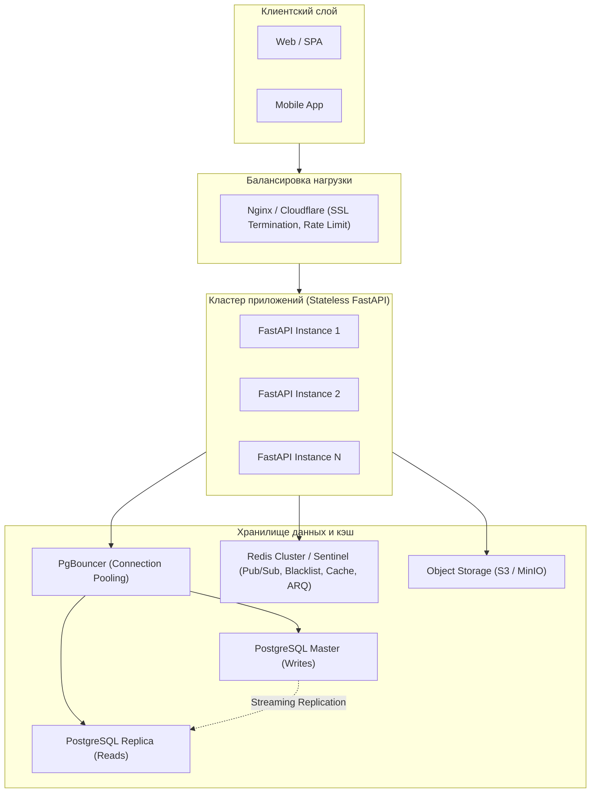

# TaskFlow: Архитектурные ограничения и стратегия масштабирования

Документ описывает текущие инженерные компромиссы, ограничения MVP-архитектуры и пошаговый план масштабирования системы до HighLoad уровня.

---

## 1. Известные ограничения текущей реализации (MVP)

| Компонент | Текущая реализация | Ограничение / Узкое место |
|---|---|---|
| **Хранилище файлов** | Локальная файловая система (`UPLOAD_DIR` в Docker volume) | Невозможно горизонтально масштабировать API-ноды без общего сетевого тома (NFS) или блочного хранилища. |
| **База данных** | Одиночный инстанс PostgreSQL 16 | Единая точка отказа (SPOF); пул соединений ограничен доступной памятью контейнера (512 МБ). |
| **Полнотекстовый поиск** | PostgreSQL `tsvector` + GIN индексы | Эффективен до ~1-2 млн записей. При большем объёме нагружает CPU базы данных; ограниченные возможности fuzzy/typo-tolerant поиска. |
| **Уведомления в реальном времени** | Redis Pub/Sub на одном узле | При падении WebSocket-соединения пропущенные сообщения теряются (fire-and-forget), так как Pub/Sub не хранит историю сообщений (в отличие от Redis Streams). |
| **Оптимистичные блокировки** | Поле `version` (OCC) | При крайне высокой частоте одновременных правок одной задачи клиенты будут часто получать `409 Conflict` и требовать перезагрузки состояния. |

---

## 2. Стратегия горизонтального и вертикального масштабирования

### Фаза 1: Оптимизация слоя данных (до 50 000 DAU)
1. **Пул соединений (PgBouncer):**
   - Установка PgBouncer перед PostgreSQL в режиме `transaction pooling` для снижения накладных расходов на создание процессов `postgres`.
2. **Read-Replicas (Реплики на чтение):**
   - Разделение запросов в SQLAlchemy: операции `SELECT` направляются на read-реплики через асинхронный роутер сессий, `INSERT/UPDATE/DELETE` — строго на Primary узел.
3. **Партиционирование таблиц:**
   - Таблицы `activity_log` и `time_entries` партиционируются по месяцам (`RANGE (created_at)`), предотвращая деградацию B-tree индексов при десятках миллионов строк.

### Фаза 2: Хранилище объектов и CDN
1. **Миграция AttachmentService на S3 API (MinIO / AWS S3):**
   - Бэкенд перестаёт пропускать через себя бинарный трафик файлов.
   - Вместо загрузки через multipart бэкенд генерирует клиенту **Pre-Signed URL** для прямой загрузки в S3-бакет.
   - Раздача статики и аватаров переносится на CDN (Cloudflare / CloudFront).

### Фаза 3: Отказоустойчивый Real-Time и Фоновые задачи
1. **Переход с Redis Pub/Sub на Redis Streams:**
   - Позволяет клиентам WebSocket восстанавливать пропущенные за время дисконнекта события благодаря `stream ID` и механизму `XREADGROUP`.
2. **Отказоустойчивость Redis (Redis Sentinel / Cluster):**
   - Автоматический failover при сбое мастера Redis без остановки фонового воркера arq и авторизации.
3. **Масштабирование воркеров:**
   - Вынесение воркеров `arq` на отдельные машины/контейнеры с независимым масштабированием по CPU.

### Фаза 4: Распределённый поиск (Search Engine)
- При росте базы задач и заметок свыше 3 миллионов записей поиск выносится в специализированный движок (**Meilisearch** или **OpenSearch**) с синхронизацией через CDC (Change Data Capture / Debezium) или асинхронные задачи arq.
